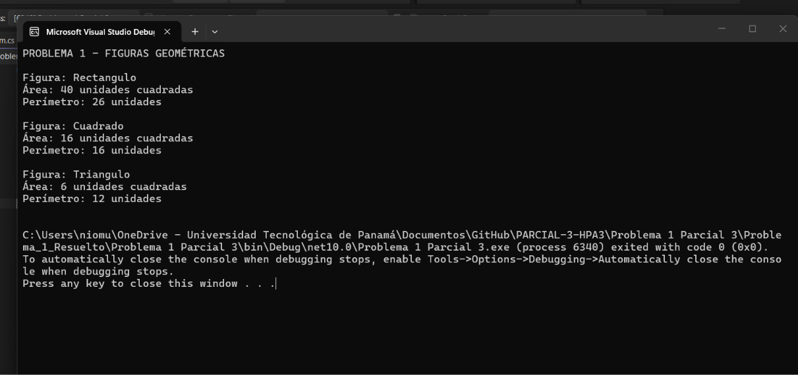
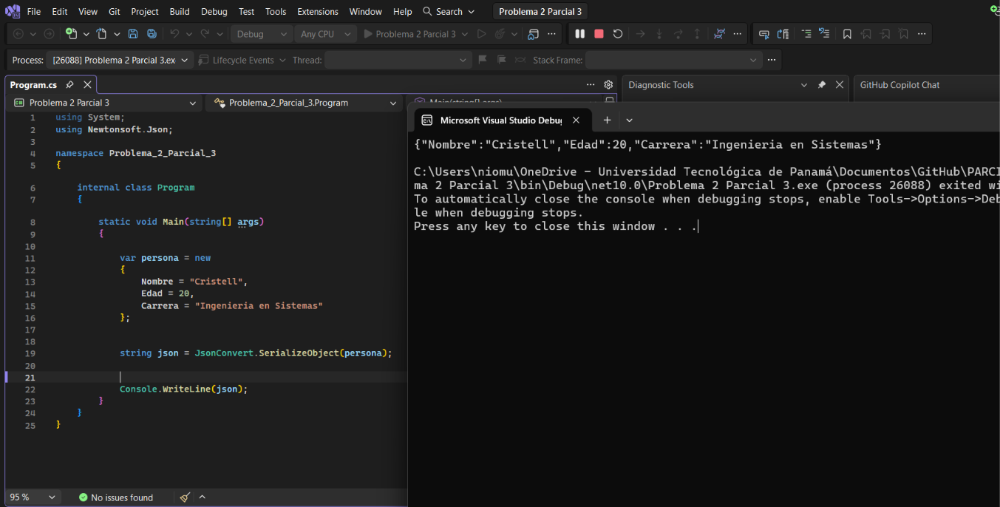
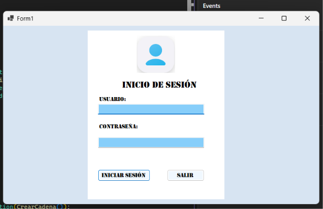
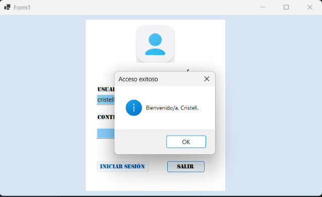
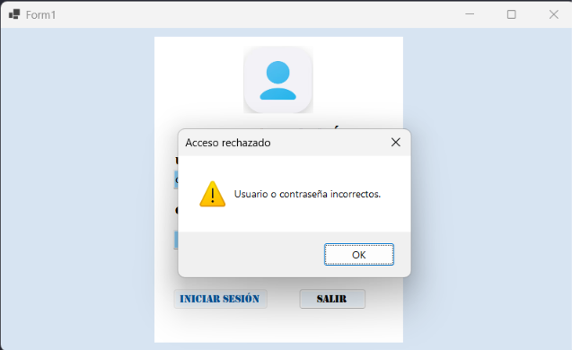

# Parcial #3 Práctico - C# y .NET

## Información del parcial

| Dato | Información |
|---|---|
| Universidad | Universidad Tecnológica de Panamá |
| Facultad | Facultad de Ingeniería de Sistemas Computacionales |
| Curso | Herramientas de la Programación Aplicada III (.NET) |
| Evaluación | Parcial #3 Práctico |
| Estudiante | Cristell Peters |
| Grupo | 1IL133 |
| Docente | Ing. Irina Fong |
| Año | 2026 |

## Objetivos

🩷 Aplicar clases abstractas, herencia y polimorfismo mediante figuras geométricas.

🩷 Convertir los datos de un objeto a formato JSON utilizando Newtonsoft.Json.

🩷 Desarrollar un login con BCrypt.Net-Next y una base de datos MySQL.

🩷 Registrar los intentos de acceso y mostrar el nombre del usuario al iniciar sesión correctamente.

## Contenido del parcial

El parcial está compuesto por **tres proyectos independientes en C#**. El primero utiliza una aplicación de consola para calcular áreas y perímetros mediante una jerarquía de clases. El segundo convierte los datos de una persona a JSON y muestra el resultado en consola. El tercero utiliza Windows Forms y MySQL para comprobar credenciales con BCrypt y guardar los intentos de inicio de sesión.

| Problema | Tema | Tipo de proyecto | Puntos |
|---|---|---|---|
| 1 | Clases abstractas, herencia y polimorfismo | Consola | 15 |
| 2 | Serialización de objetos a JSON | Consola | 15 |
| 3 | Login con BCrypt y registro de accesos | Windows Forms | 20 |

## Problema 1: Figuras geométricas

### 🩷 Trabajo realizado

Se creó una clase abstracta llamada `Figura`, con los métodos abstractos `CalcularArea()` y `CalcularPerimetro()`. A partir de ella se implementaron `Rectangulo`, `Cuadrado` y `Triangulo`.

Cada clase hija recibe sus medidas mediante un constructor y utiliza `override` para implementar las fórmulas correspondientes.

| Clase | Área | Perímetro |
|---|---|---|
| `Rectangulo` | Base × altura | 2 × (base + altura) |
| `Cuadrado` | Lado × lado | 4 × lado |
| `Triangulo` | (Base × altura) / 2 | Suma de sus tres lados |

### 🩷 Arreglo y recorrido polimórfico

En `Program.cs` se declaró un arreglo unidimensional de tipo `Figura[]` con objetos de las tres clases. Mediante un `foreach`, el programa muestra el nombre de cada clase, su área y su perímetro.

Aunque la variable del recorrido es de tipo `Figura`, se ejecutan los métodos de la clase concreta de cada objeto. De esta forma se aplica el polimorfismo solicitado.

Las medidas están definidas en el código, ya que el enunciado no solicita ingresarlas por teclado.

| Figura del ejemplo | Medidas | Área | Perímetro |
|---|---|---|---|
| Rectángulo | Base 8, altura 5 | 40 | 26 |
| Cuadrado | Lado 4 | 16 | 16 |
| Triángulo rectángulo | Base 3, altura 4; lados 3, 4 y 5 | 6 | 12 |



## Problema 2: Conversión de datos a JSON

### 🩷 Trabajo realizado

Se utiliza la biblioteca **Newtonsoft.Json** para convertir un objeto de C# a una cadena JSON. El objeto `persona` contiene los datos del ejemplo: nombre Cristell, edad 20 y carrera Ingeniería en Sistemas.

La conversión se realiza con `JsonConvert.SerializeObject(persona)` y el resultado se muestra mediante `Console.WriteLine(json)`.

```json
{"Nombre":"Cristell","Edad":20,"Carrera":"Ingenieria en Sistemas"}
```

Este proyecto permite representar los datos del objeto en un formato de intercambio. No requiere formulario ni base de datos.



## Problema 3: Login con BCrypt y MySQL
| Usuario de prueba | Contraseña |
|---|---|
| `cristell` | `Cristell123*` |

### 🩷 Diseño de la aplicación

Se desarrolló un formulario con una imagen, título, campos de usuario y contraseña, y los botones **Iniciar sesión** y **Salir**. Se utilizaron tonos azules y un panel central para agrupar los controles.

El diseño se encuentra en `Form1.Designer.cs`, sus recursos en `Form1.resx` y los eventos en `Form1.cs`. La contraseña se muestra oculta al escribir.



### 🩷 Generación del hash

En `AccesoDatos.cs`, el método `PrepararUsuarioAsync()` comprueba si existe el usuario de prueba `cristell`. Cuando no existe, genera el hash mediante `BCrypt.Net.BCrypt.HashPassword(...)` y guarda la cuenta en la tabla `Usuarios`.

Si el usuario ya fue creado con el SQL, se conserva el registro y se utiliza su hash existente. La contraseña original no se almacena en el campo `PasswordHash`.

### 🩷 Verificación y acceso exitoso

El método `AutenticarAsync()` consulta el usuario y recupera su nombre y hash. Luego utiliza `BCrypt.Net.BCrypt.Verify(contrasena, hash)` para comprobar la contraseña ingresada.

Si el resultado es correcto, se guarda el intento exitoso y el formulario muestra un mensaje con el nombre obtenido de la base de datos: **Bienvenido/a, Cristell.**



### 🩷 Acceso fallido

Si la contraseña es incorrecta o el usuario no existe, se guarda el intento fallido y aparece el mensaje **Usuario o contraseña incorrectos.**

Cuando falta el usuario o la contraseña, se solicita completar los campos antes de consultar las credenciales.



### 🩷 Base de datos y registro de intentos

La base de datos se llama `login_bcrypt`. Su estructura se crea desde MySQL Workbench mediante `BaseDatos/backup_login_bcrypt.sql`.

| Tabla | Campos | Función |
|---|---|---|
| `Usuarios` | `IdUsuario`, `Nombre`, `Usuario`, `PasswordHash` | Almacena las cuentas y los hashes. |
| `IntentosAcceso` | `IdIntento`, `IdUsuario`, `UsuarioIngresado`, `FechaHora`, `Exitoso` | Almacena los intentos de autenticación. |

El programa registra el usuario ingresado, la fecha y hora, y el resultado del acceso. `Exitoso` vale `1` para un intento correcto y `0` para uno fallido. Si la cuenta no existe, conserva el texto ingresado y guarda `IdUsuario` como `NULL`.

Los registros se pueden revisar ejecutando `BaseDatos/consultas.sql`. La creación de la base y las tablas queda en el SQL; el código C# consulta e inserta los datos.

### 🩷 Conexión con MySQL

Se utiliza **MySqlConnector**. El método `CrearCadena()` de `AccesoDatos.cs` lee el servidor, puerto, usuario y contraseña de MySQL desde `conexion.json`.

Las consultas utilizan parámetros. La contraseña de conexión a MySQL es independiente de la cuenta que se escribe en el formulario del login.


## Backup de la base de datos

El problema 3 incluye un SQL con la estructura y el usuario inicial. Después de realizar las pruebas, se debe exportar desde Workbench la base `login_bcrypt` con **estructura y datos** para incluir también los intentos registrados.

El repositorio reúne los tres proyectos y el backup de la base de datos solicitado para el login.

## Herramientas utilizadas

| Herramienta | Uso |
|---|---|
| C# y .NET | Desarrollo de los tres programas. |
| Visual Studio | Edición y ejecución de los proyectos. |
| Consola | Presentación de los resultados de figuras y JSON. |
| Windows Forms | Interfaz del login. |
| Newtonsoft.Json | Serialización del objeto persona. |
| BCrypt.Net-Next | Generación y verificación de hashes. |
| MySqlConnector | Conexión del login a MySQL. |
| MySQL y MySQL Workbench | Almacenamiento, consultas y respaldo de datos. |
| GitHub | Organización y entrega del código y documentación. |

## Resultado del trabajo

En este parcial se trabajaron tres temas mediante proyectos separados. Con las figuras se aplicaron clases abstractas, herencia y polimorfismo; con el segundo ejercicio se representaron datos en JSON; y con el login se integraron BCrypt, Windows Forms y MySQL para verificar contraseñas y registrar los accesos.
